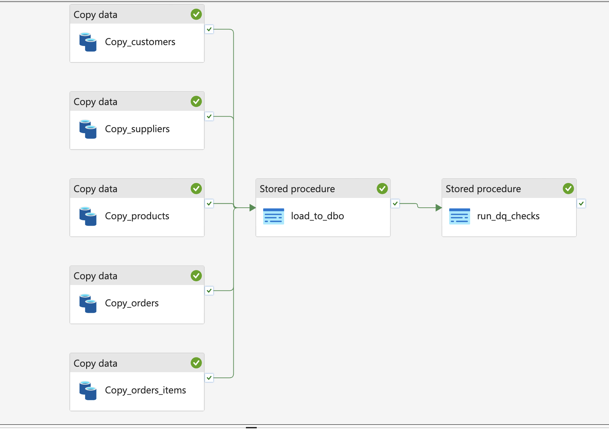
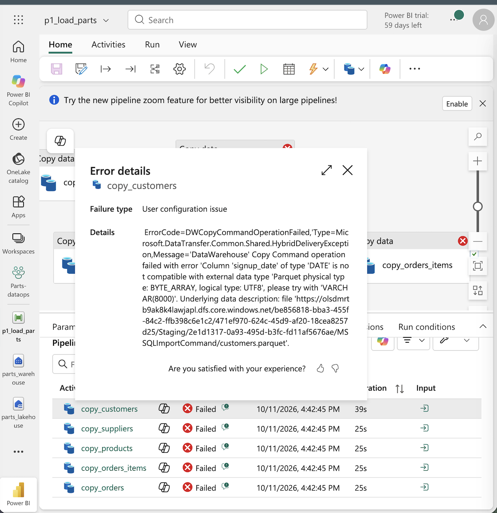
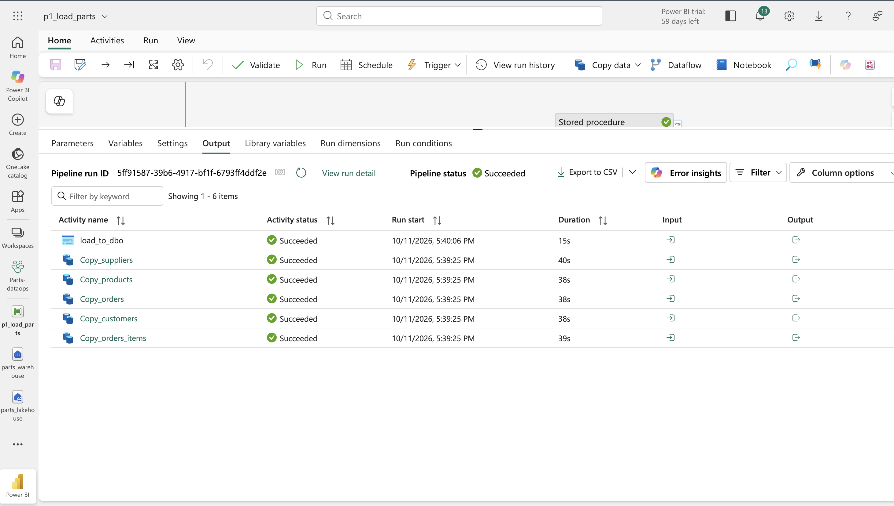
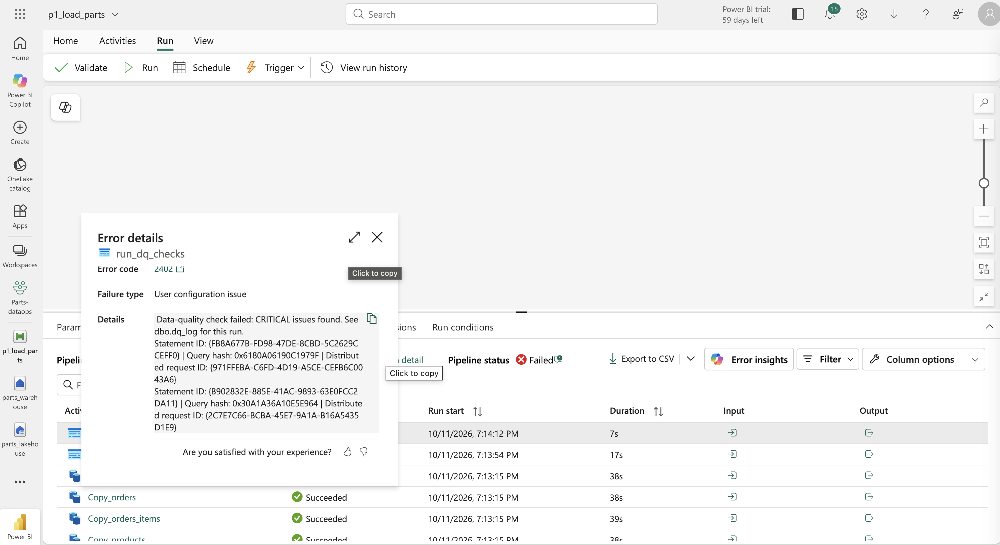
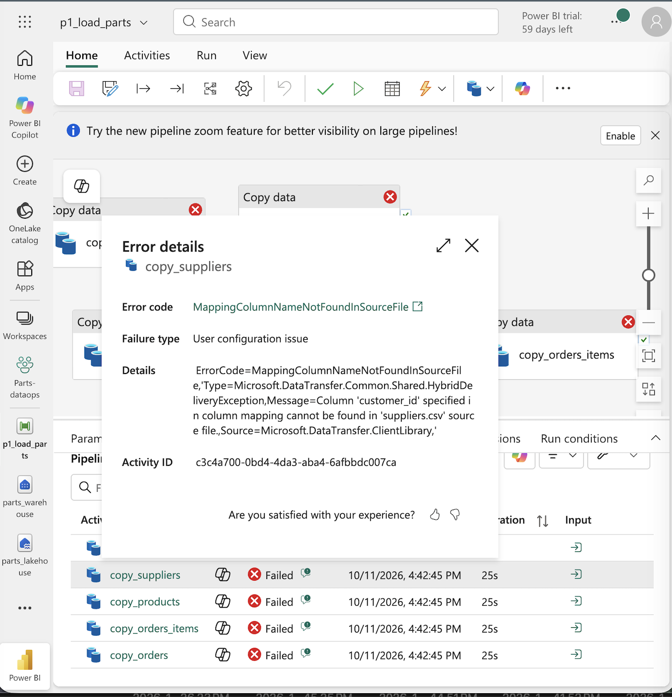
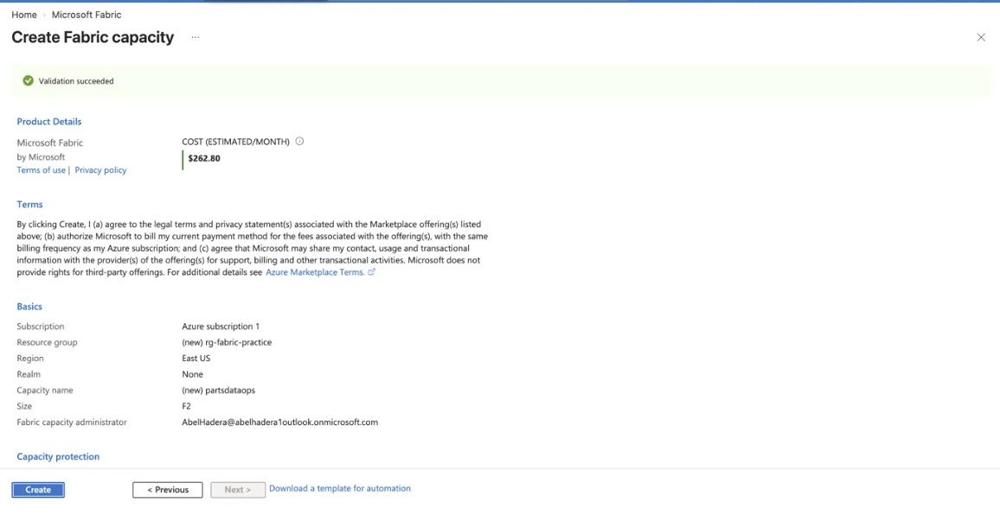

# fabric-parts-dataops

A small, end-to-end data pipeline on **Microsoft Fabric**, built to get hands-on experience with the platform side of DataOps: provisioning capacity, loading data, validating it, and handling failures.

The data is a practice auto-parts database (customers, suppliers, products, orders, order items) that originally lived in a local SQL Server instance.

> **Status:** Load, transform, and automated data-quality checks complete, including a deliberate duplicate-load incident that the checks caught ([incident 001](docs/incident-001-duplicate-load.md)). Scheduling is next (see [Roadmap](#roadmap)).

---

## Architecture

```
SQL Server (local, Docker)
        │  export to CSV (DBeaver)
        ▼
Lakehouse  ── Files/raw/*.csv          (landing zone, files kept as received)
        │  Pipeline: 5 Copy data activities (run in parallel)
        ▼
Warehouse  ── stg.*  (all columns VARCHAR)
        │  Stored procedure: dbo.usp_load_from_staging (TRY_CAST + NULLIF)
        ▼
Warehouse  ── dbo.*  (typed tables)
        │  Stored procedure: dbo.usp_run_dq_checks
        ▼
Warehouse  ── dbo.dq_log  (one row per check per run; THROWs on CRITICAL, failing the pipeline)
```

| Component | Name |
|---|---|
| Capacity | `partsdataops` (F2, East US, pay-as-you-go) |
| Workspace | `parts-dataops` |
| Lakehouse | `parts_lakehouse` |
| Warehouse | `parts_warehouse` |
| Pipeline | `p1_load_parts` |



### Why a staging layer

The first version copied CSVs straight into typed tables and failed:

```
Column 'signup_date' of type 'DATE' is not compatible with external data type
'Parquet physical type: BYTE_ARRAY, logical type: UTF8'
```

CSV files carry no type information, so every value arrives as text, and Fabric Warehouse will not implicitly load text into a `DATE` column. Instead of fighting the copy activity's mapping, the pipeline now:

1. Copies each CSV into a **staging table where every column is `VARCHAR`** (text into text never fails).
2. Converts in T-SQL with `TRY_CAST`, where the conversion logic is visible, testable, and version-controlled.



`NULLIF(column, '')` runs before every `TRY_CAST`, because `TRY_CAST('' AS DATE)` returns `1900-01-01` and `TRY_CAST('' AS INT)` returns `0` rather than NULL. Without it, unshipped orders would silently get a ship date of January 1, 1900.

---

## Repository layout

```
sql/
  01_create_dbo_tables.sql          typed destination tables
  02_add_primary_keys.sql           primary keys (NOT ENFORCED, as Fabric requires)
  03_create_stg_tables.sql          staging schema and all-VARCHAR tables
  04_usp_load_from_staging.sql      stg -> dbo transform procedure (original, append-only)
  05_validation_queries.sql         row counts and conversion checks
  06_create_dq_log.sql              data-quality results table
  07_usp_run_dq_checks.sql          data-quality checks; fails the run on CRITICAL issues
  08_fix_rerun_safe_load.sql        incident 001 fix: truncate-and-reload
docs/
  incident-001-duplicate-load.md    write-up of the duplicate-load incident
  sqlserver-vs-fabric.md            behavior differences found while migrating
  troubleshooting-log.md            every error hit during the build and how it was fixed
  screenshots/                      pipeline canvas, run output, monitoring
data/                               the five source CSVs
```

---

## Validation

After each run, row counts in `dbo` must match the source:

| Table | Rows |
|---|---|
| customers | 155 |
| suppliers | 15 |
| products | 62 |
| orders | 307 |
| order_items | 772 |

Conversion checks (see `sql/05_validation_queries.sql`):

- Unshipped orders keep a real NULL `ship_date` (about 30 rows).
- Zero rows with a `1900-01-01` date, which would indicate empty strings converted incorrectly.
- Customers without a middle name keep a real NULL (about 51 rows).



---

## Data-quality checks

`dbo.usp_run_dq_checks` runs after every load and writes one row per check to `dbo.dq_log`:

| Severity | Checks | Effect |
|---|---|---|
| CRITICAL | Duplicate primary keys (all 5 tables), NULL order IDs, `1900-01-01` ship dates | `THROW` fails the pipeline run |
| WARNING | Orphaned orders, orphaned order items, negative stock, zero-price products | Logged only |

Only problems that make the data wrong to use fail the run; known data issues are logged for review instead of paging someone, to avoid alert fatigue. Duplicate checks matter in Fabric specifically because primary keys are `NOT ENFORCED`.

Timestamps in `dq_log` are stored in UTC and converted for display, because daylight saving creates a repeated hour each November:

```sql
SELECT CAST(run_at AT TIME ZONE 'UTC' AT TIME ZONE 'Eastern Standard Time' AS DATETIME2(0)) AS run_at_eastern,
       check_name, severity, failed_rows
FROM dbo.dq_log
ORDER BY run_at DESC, severity, check_name;
```


### Incident 001: duplicate load on rerun

A deliberate rerun tripled every table, because both the copy activities and the load procedure appended instead of replacing. The checks failed the run; the fix was truncate-and-reload at both layers. Full write-up: [`docs/incident-001-duplicate-load.md`](docs/incident-001-duplicate-load.md).



---

## Notable failures

Full details for every issue are in [`docs/troubleshooting-log.md`](docs/troubleshooting-log.md). Two worth showing:

**Copied column mappings.** Four copy activities were duplicated from `copy_customers`. Changing the source file didn't reset the column mapping, so `copy_suppliers` looked for `customer_id` in `suppliers.csv`. Fix: Mapping → Reset → Import schemas on each activity. Lesson: get one activity working end to end before cloning it.



**Text dates into a DATE column.** Shown above under [Why a staging layer](#why-a-staging-layer).

---

## Cost

Fabric's free trial is not available to newly created tenants, so this project runs on a paid **F2** capacity, the smallest SKU.

- Pay-as-you-go, billed per second while running; **paused whenever not in use**.
- A $10 Azure budget alert guards against forgetting to pause.
- Default size in the Azure create form was F64; it was changed to F2 before creation.
- Total cost for the build: _fill in from Azure Cost Management_.



---

## Roadmap

- [x] Provision F2 capacity, workspace, Lakehouse, Warehouse
- [x] Land raw CSVs in the Lakehouse
- [x] Create typed `dbo` tables and `stg` staging tables
- [x] Pipeline: 5 parallel copy activities into staging
- [x] Transform procedure from staging to typed tables, validated against source counts
- [x] Data-quality procedure that logs check results and fails the pipeline on critical issues
- [x] Deliberate rerun to trigger a duplicate-load failure; investigate in the Monitoring hub; fix and document as an incident
- [ ] Schedule the pipeline and confirm a scheduled run
- [ ] Optional: connect the workspace to this repo with Fabric Git integration
