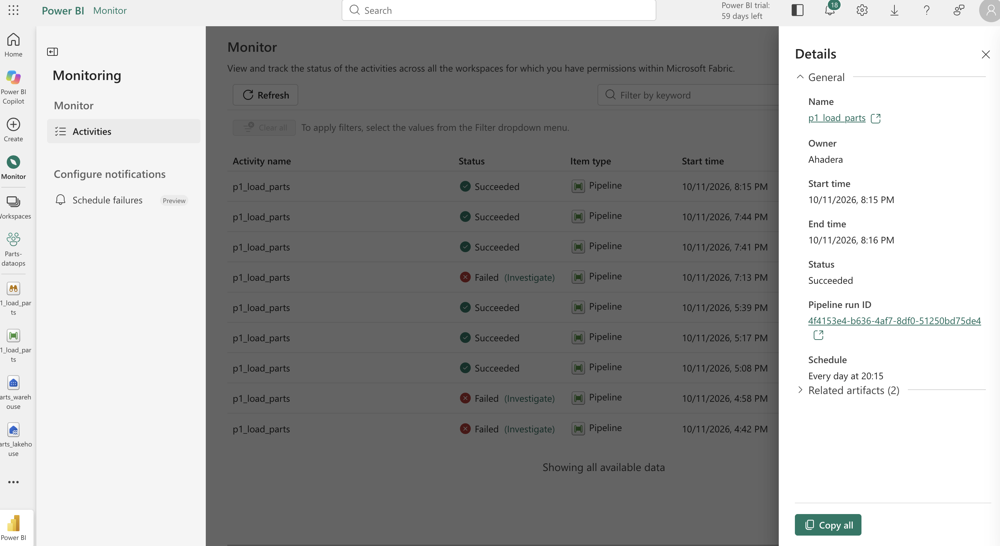
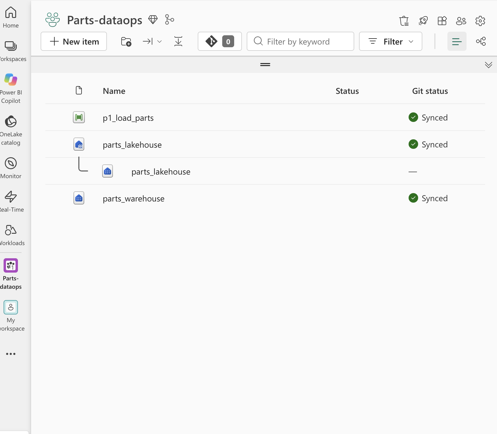
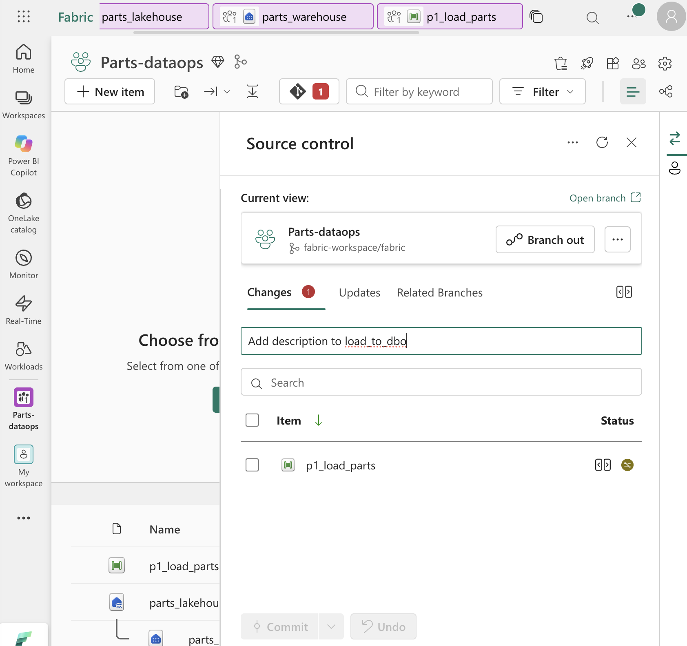
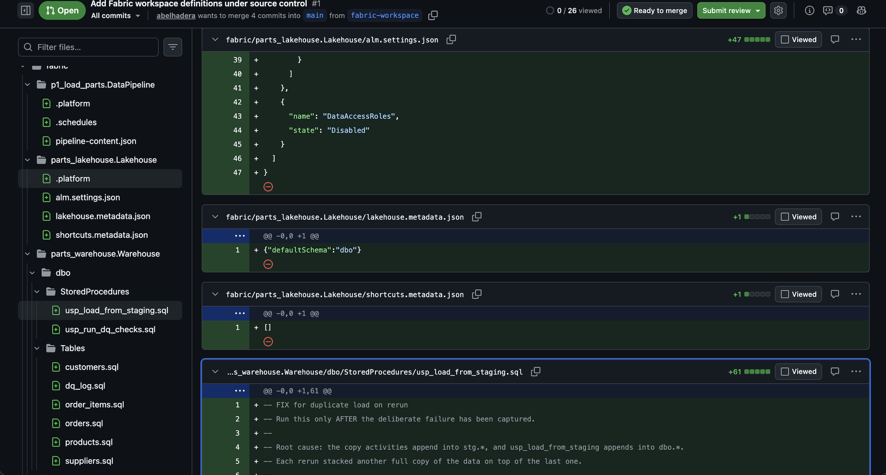

# fabric-parts-dataops

I built this to get hands-on with Microsoft Fabric before a DataOps interview. It takes a small auto-parts database (customers, suppliers, products, orders, order items), loads it into Fabric, checks the data after every load, and fails the run when something's wrong.

## How it works

```
CSV files ──► Lakehouse (raw files)
          ──► Warehouse stg.*   (all VARCHAR)       5 copy activities
          ──► Warehouse dbo.*   (typed tables)      usp_load_from_staging
          ──► dbo.dq_log        (quality results)   usp_run_dq_checks
```


## Setup

Fabric's free trial isn't available to brand-new tenants, so I used a paid F2 capacity, the smallest one. I pause it whenever I'm not using it and set a $10 budget alert in case I forget. The create form defaulted to F64, which would have been about 32 times the cost, so that's worth double-checking.


## Problems I hit along the way

**Copied mappings.** I built one copy activity and duplicated it for the other four tables. Changing the source file didn't reset the column mapping, so the suppliers copy went looking for `customer_id`. I reset and re-imported the schema on each one. Next time I'll get one activity fully working before cloning it.


**Dates arriving as text.** CSVs don't carry types, so everything shows up as text, and Fabric won't load text into a `DATE` column. Instead of fighting the copy settings, I load everything into all-`VARCHAR` staging tables and convert it in SQL with `TRY_CAST`. I also wrap each column in `NULLIF(col, '')` first, because `TRY_CAST('' AS DATE)` quietly returns January 1, 1900 instead of NULL.


Once both were fixed, the full load ran clean.


## Data-quality checks

Primary keys in Fabric aren't enforced, so nothing stops duplicate rows from loading. After every load, a stored procedure runs a set of checks and logs the results to `dq_log`:

- **Critical** (fails the pipeline): duplicate IDs, missing order IDs, `1900-01-01` dates
- **Warning** (logged only): orphaned records, negative stock, zero prices

I kept the critical list short on purpose. If everything fails the run, people stop paying attention to failures. Timestamps are stored in UTC and converted when I read them, since daylight saving repeats an hour every November.


## Breaking it on purpose

To test the checks, I reran the pipeline without changing anything. Every table tripled: the copy activities appended to staging, and then the load procedure appended all of staging on top of what was already there. The duplicate checks caught it and failed the run.


The fix was to truncate before loading at both layers, so a rerun replaces the data instead of stacking it. Two reruns afterward came back with the right counts. I wrote it up like a real incident: [incident-001](docs/incident-001-duplicate-load.md).


## Scheduling

I scheduled the pipeline daily, confirmed a run kicked off on its own, then turned the schedule off since the capacity stays paused most of the time. The run history shows the whole build in order: the early failures, the deliberate one, the reruns after the fix, and the scheduled run.



## Source control

I connected the Fabric workspace to this repo on a `fabric-workspace` branch. Fabric writes the pipeline and the warehouse (every table and stored procedure as its own `.sql` file) into the `fabric/` folder, and changes reach `main` through a pull request.







## What's in the repo

```
fabric/   workspace definitions, synced by Fabric
sql/      table, procedure, and validation scripts, in the order I ran them
docs/     incident write-up, troubleshooting log, SQL Server vs Fabric notes, screenshots
data/     the source CSVs
```
