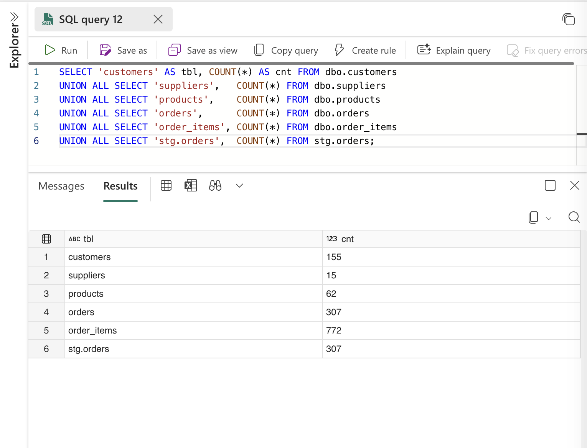

# Incident 001: Duplicate load on pipeline rerun

**Date:** 2026-10-11
**Pipeline:** `p1_load_parts`
**Severity:** Critical (every table tripled; all downstream numbers wrong)
**Detected by:** `run_dq_checks` (automated), not by a person
**Status:** Resolved

## Summary

Rerunning the pipeline appended a full copy of the data at both the staging and the typed layer instead of replacing it. Every `dbo` table ended up at exactly 3× its source row count. The data-quality step caught it and failed the run, so the problem was visible in the Monitoring hub instead of silently flowing into reports.

The rerun was deliberate: it tested whether the pipeline could be rerun safely and whether the checks would catch it if not.

## Detection

`run_dq_checks` failed with the procedure's own error:

```
Data-quality check failed: CRITICAL issues found. See dbo.dq_log for this run.
```


## Impact

| Table | Expected | After rerun |
|---|---|---|
| customers | 155 | 465 |
| suppliers | 15 | 45 |
| products | 62 | 186 |
| orders | 307 | 921 |
| order_items | 772 | 2,316 |

`dbo.dq_log` for the failed run:

| Check | Severity | Failed rows |
|---|---|---|
| duplicate_customer_ids | CRITICAL | 155 |
| duplicate_supplier_ids | CRITICAL | 15 |
| duplicate_part_ids | CRITICAL | 62 |
| duplicate_order_ids | CRITICAL | 307 |
| duplicate_order_item_ids | CRITICAL | 772 |
| negative_stock | WARNING | 6 (normally 2) |
| orphaned_order_items | WARNING | 9 (normally 3) |
| orphaned_orders | WARNING | 12 (normally 4) |
| zero_price_products | WARNING | 6 (normally 2) |

The WARNING counts tripled as well. Duplicates don't only inflate row counts: every metric built on this data (revenue, order counts, stock levels) would have been 3× too high, with no error anywhere. Primary keys in Fabric Warehouse are `NOT ENFORCED`, so the database itself would not have stopped this.

## Root cause

Both layers appended instead of replacing:

| Layer | Before | After | Why |
|---|---|---|---|
| `stg.orders` | 307 | 614 (2×) | Copy activities insert into staging without clearing it |
| `dbo.orders` | 307 | 921 (3×) | `usp_load_from_staging` inserted all 614 staging rows on top of the existing 307 |

Checking staging separately is what showed it was two bugs, not one. Fixing only the load procedure would still have loaded doubled staging data.

## Fix

1. **Load procedure** (`sql/08_fix_rerun_safe_load.sql`): `usp_load_from_staging` now truncates the five `dbo` tables before inserting.
2. **Copy activities**: each has a pre-copy script, e.g. `TRUNCATE TABLE stg.orders;`, so staging is cleared before each copy.

No manual cleanup was needed: the next run truncated both layers and rebuilt everything from the source CSVs.

## Verification

- Row counts back to 155 / 15 / 62 / 307 / 772; `stg.orders` = 307.
- All CRITICAL checks 0; WARNINGs back to 2 / 3 / 4 / 2.
- Ran the pipeline a second time with identical results, confirming it's safe to rerun.



## Prevention and follow-ups

- The duplicate checks stay in the pipeline, so any future non-rerun-safe change fails loudly.
- **Trade-off:** truncate-and-reload is right for small tables. For large tables, an incremental load with `MERGE` (update changed rows, insert new ones) would avoid reloading everything each run.
- **Gap:** truncate and insert are not wrapped in a transaction, so a failure mid-load could leave `dbo` partially empty. A production version should wrap the load in a transaction or load into new tables and swap.
